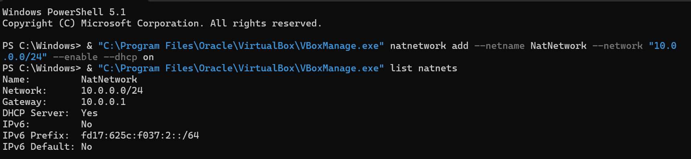
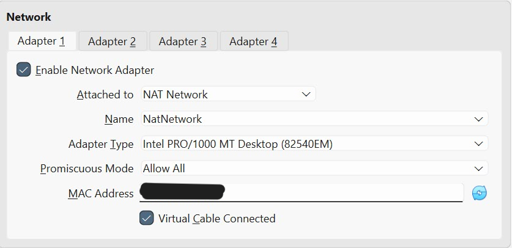
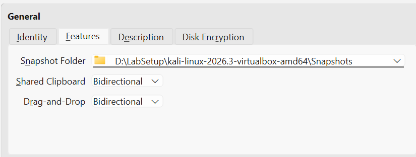
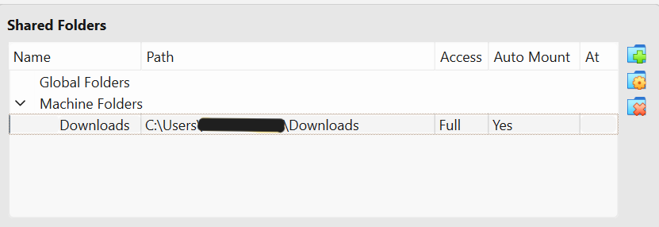
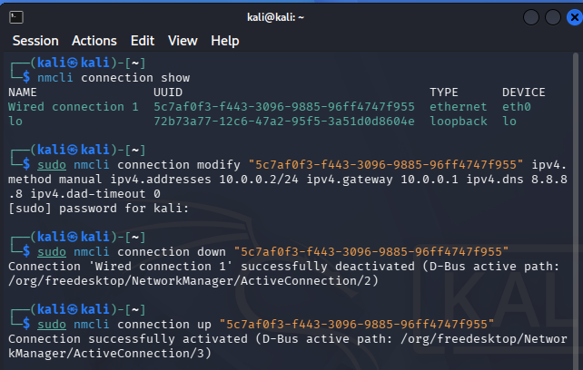
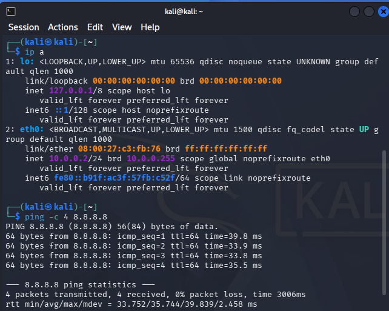
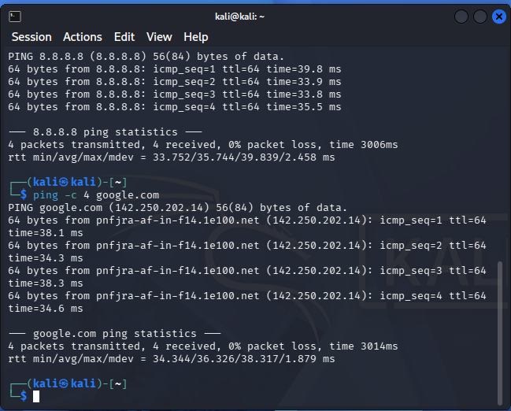
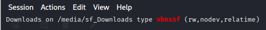
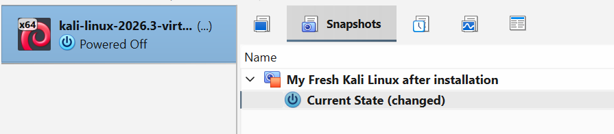
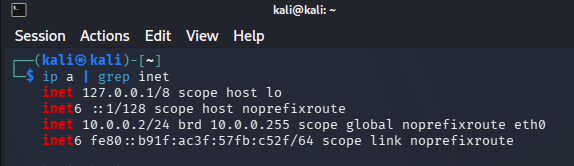

# Cybersecurity Lab Environment Setup

Building an isolated virtual lab for ethical hacking practice.
Networkwalks Cybersecurity Internship | Week 1 | Project Module 1

## Project Overview
I set up a virtual cybersecurity lab on my own PC using VirtualBox and Kali Linux. The lab runs on a private NAT Network, so more machines can be added later and used as targets for authorized security testing only.

## Lab Requirements
- VirtualBox (latest version)
- Kali Linux 2026.3 (VirtualBox VM image)
- NAT Network: 10.0.0.0/24
- Kali IP address: 10.0.0.2/24
- Shared clipboard and drag and drop enabled
- Shared folder from the host (Downloads)
- Full Internet access

## Steps

### 1. Installed the tools
I installed VirtualBox and 7-Zip on my Windows PC. Then I downloaded the Kali Linux 2026.3 VirtualBox VM image from kali.org and checked its SHA256 hash against the one published on the website. The hashes matched, so the download was not corrupted.

### 2. Created the NAT Network
My VirtualBox version has no separate Network tool in the menu, so I created the NAT Network with VBoxManage in PowerShell. It shows 10.0.0.0/24 with DHCP enabled.

### 3. Imported Kali and attached it to the NAT Network
After extracting the image with 7-Zip, I imported the VM. In the VM settings I set Adapter 1 to NAT Network (NatNetwork) and Promiscuous Mode to Allow All.

### 4. Enabled shared clipboard and drag and drop
Both are set to Bidirectional.

### 5. Added the shared folder
I shared my Windows Downloads folder with Full access and Auto-mount.

### 6. Set the static IP in Kali
I used nmcli to set the address 10.0.0.2/24, gateway 10.0.0.1 and DNS 8.8.8.8, and turned off the duplicate address detection timeout to avoid Internet problems on newer Kali versions.

### 7. Verified the IP and Internet access
The interface shows 10.0.0.2/24, and pings to 8.8.8.8 and google.com succeed with 0% packet loss.

### 8. Verified the shared folder
The Downloads folder is mounted in Kali as a vboxsf share, with read and write access.

### 9. Took a snapshot
I took a snapshot of the fresh, working setup so I can restore it if something breaks.

### 10. Reboot check
After restarting Kali, the static IP was still applied, so the configuration is permanent.

## Troubleshooting

**Problem 1: The Network tool was missing from my VirtualBox menu.**
My newer VirtualBox version has no Network entry under Tools, so I could not create the NAT Network from the menu. I created it with VBoxManage in PowerShell instead and confirmed it with the list natnets command.

**Problem 2: The Kali VM would not boot (GRUB rescue "file not found" error).**
The first extraction of the 15 GB disk image was corrupted, because I used the Windows built-in extractor. Turning EFI on and off did not help. I checked that the SHA256 hash of the download was correct, then deleted the broken VM and extracted the archive again with 7-Zip. After that, the VM booted normally.

## Conclusion
This project taught me how to build a safe virtual lab with an isolated network, a static IP, a shared folder and snapshots. I also learned to troubleshoot boot and menu problems by checking file integrity and finding other ways to do the same task. All testing will stay inside this lab, which I own.

All work was done in my own lab environment.
